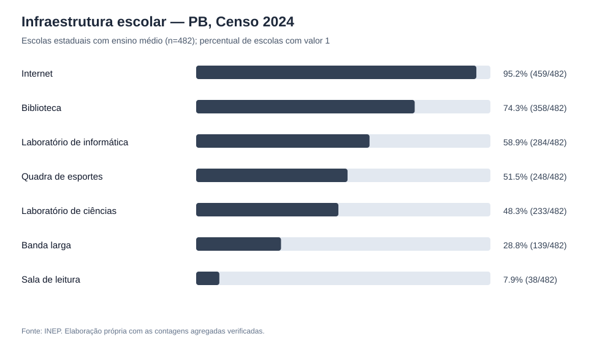
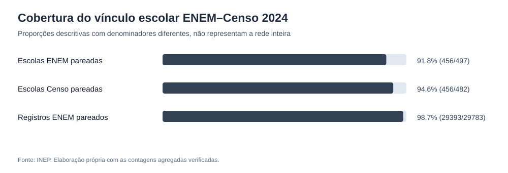

# Análise exploratória preliminar — Educação estadual da Paraíba

Relatório gerado automaticamente a partir de **dados agregados publicados**.
Não realizou junção de participantes, não calculou causalidade e não extrapola o ENEM para toda a rede.

## 1. Escolas e matrículas (Censo Escolar 2024)

- Escolas estaduais com oferta de ensino médio: **482**.
- Municípios com escolas estaduais de ensino médio: **223**.
- Matrículas de ensino médio declaradas no recorte: **116.779**.

## 2. Infraestrutura das escolas estaduais com ensino médio (2024)

| Indicador declarado | Presente (1) | Ausente (0) | Não informado | Percentual presente do total |
|---|---:|---:|---:|---:|
| Internet | 459 | 23 | 0 | 95.23% |
| Biblioteca | 358 | 124 | 0 | 74.27% |
| Laboratório de informática | 284 | 198 | 0 | 58.92% |
| Quadra de esportes | 248 | 234 | 0 | 51.45% |
| Laboratório de ciências | 233 | 249 | 0 | 48.34% |
| Banda larga | 139 | 320 | 23 | 28.84% |
| Sala de leitura | 38 | 444 | 0 | 7.88% |

A diferença entre internet declarada e banda larga declarada sugere uma **pergunta para auditoria de conectividade**,
mas os códigos e a infraestrutura efetiva devem ser conferidos antes de propor intervenção.

## 3. Cobertura do relacionamento por escola (ENEM–Censo 2024)

| Indicador | Valor |
|---|---:|
| Escolas ENEM estaduais PB | 497 |
| Escolas Censo estaduais com ensino médio | 482 |
| Escolas em ambas as bases | 456 |
| Cobertura das escolas ENEM | 91.75% |
| Cobertura das escolas Censo | 94.61% |
| Registros ENEM pareados | 29393 / 29783 (98.69%) |

Os denominadores são diferentes. As 41 escolas do ENEM sem par no Censo e as 26 do Censo sem
participantes pareados precisam de investigação; não são necessariamente erros.

## 4. Notas válidas no ENEM 2024 — participantes com escola estadual identificada

| Área | Registros com nota válida | Média descritiva |
|---|---:|---:|
| Ciências da Natureza | 21786 | 456.53 |
| Ciências Humanas | 22487 | 467.67 |
| Linguagens | 22487 | 489.85 |
| Matemática | 21786 | 476.81 |
| Redação | 22487 | 571.92 |

As quantidades variam por área, e cada nota pertence somente aos participantes com escola identificada
e nota válida. As escalas e composições dos grupos não autorizam classificar áreas apenas pela média.

## 5. IDEB 2025 — escolas estaduais com nota divulgada

- Escolas estaduais na planilha: **478**.
- Escolas com IDEB 2025 numérico: **458** (95.82%).
- Escolas sem nota válida: **20**.
- Média aritmética simples por escola com nota: **4.267**.
- Mediana por escola com nota: **4.3**.

A média simples não corresponde necessariamente ao IDEB oficial da rede. O IDEB de 2025 e o Censo de 2024
referem-se a períodos distintos; as suas populações não devem ser comparadas como se fossem idênticas.

## 6. Perguntas para próxima análise

1. Quais municípios apresentam maior proporção de escolas sem determinados recursos?
2. A cobertura do ENEM por escola varia sistematicamente com porte e território?
3. Como diferem as distribuições escolares do IDEB 2025 quando consideradas as 20 escolas sem nota válida?
4. Quais variáveis permanecem consistentes após a limpeza e a integração por escola?

## 7. Limitações

- As proporções de infraestrutura são quantidades declaradas pelas escolas.
- O ENEM é voluntário; este subconjunto não representa todos os estudantes da rede.
- Nenhuma informação socioeconômica foi vinculada individualmente às notas.
- Nenhuma correlação ou efeito causal foi estimado entre infraestrutura e aprendizagem.
- Não se deve igualar a média simples do IDEB 2025 ao índice oficial agregado da rede.
- As escolas não pareadas necessitam de investigação de cobertura e período.

## Fontes reprodutíveis

- [Perfil agregado ENEM e Censo](../inspecao/perfil_paraiba.md)
- [IDEB 2025 por escola](../inspecao/ideb_pb_2025.md)
- [Auditoria de correspondência ENEM–Censo](../filtragem/validacao_chaves_2024.md)
- [Código de geração do relatório](../../src/05_exploracao_preliminar.py)
